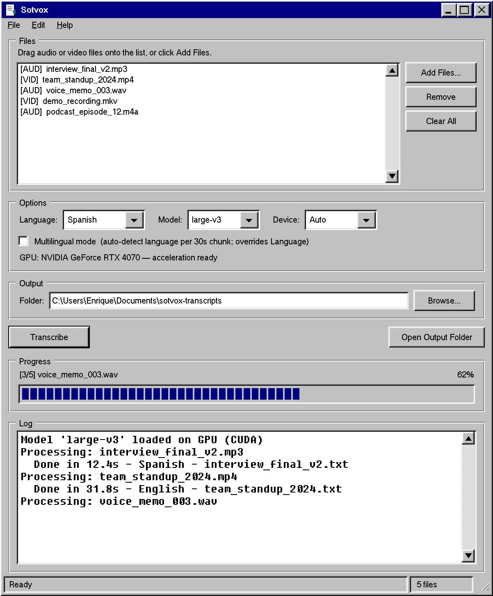

# Sotvox

Turn audio and video into text on your own PC. No internet, no account, no subscription.



## Install

### Windows

1. Download **[Sotvox-Setup.exe](https://github.com/EnriqueOliva/sotvox/releases/latest)**
2. Run it and follow the wizard
3. Open **Sotvox** from the Start Menu

Windows 10 or 11. Nothing else to install.

### macOS

1. Download **Sotvox-macOS.dmg** (or build it yourself, see [Build on macOS](#build-on-macos))
2. Open it and drag **Sotvox** into **Applications**
3. The first time, macOS will refuse to open it because the app is not notarized by Apple. Go to **System Settings** → **Privacy & Security**, scroll down and click **Open Anyway**

macOS 11 or newer on Apple Silicon. Nothing else to install.

## Use it

1. Drag your files onto the list
2. Click **Transcribe**
3. When it finishes, the new transcripts are already on the clipboard as files. Paste them into a chat, an email or another folder
4. **Open Output Folder** opens the folder with the new transcripts selected, and **Copy Transcripts** puts them back on the clipboard if you copied something else in between

Each file becomes a `.txt` next to the others in `C:\dasbanq\dasbanq-learning\transcripts` (`~/Documents/sotvox-transcripts` on macOS).

**Audio:** mp3, wav, m4a, ogg, flac, wma, aac
**Video:** mp4, mkv, avi, mov, webm, wmv, ts, flv

## Options

| Setting | What it does |
| --- | --- |
| **Language** | The language spoken in your files, or *Auto-detect* |
| **Model** | `large-v3` is the most accurate, `large-v3-turbo` nearly as good but much faster |
| **Device** | Leave on *Auto* (macOS always uses the CPU) |
| **Multilingual mode** | For files that switch between languages |
| **Folder** | Where transcripts are saved |
| **Transcribe new audio and video saved to Downloads** | Anything new that lands in Downloads is transcribed and copied to the clipboard on its own. An older transcript with the same name is kept, and the new one gets the date added |
| **Start with Windows** | Opens Sotvox minimized when you sign in, so the Downloads watch is always on (Windows only) |

## Advanced settings

Two more settings live in `settings.json`, in `%LOCALAPPDATA%\Sotvox` (`~/Library/Application Support/Sotvox` on macOS). Both the window and the headless batch mode read them at the start of every run.

```json
{
  "replacements": { "dasbank": "Dasbanq", "das bank": "Dasbanq" },
  "speaker_tracks": { "2": "Me", "3": "Others" }
}
```

- **`replacements`** fixes words the model always mishears, such as a company or product name. Each key is replaced by its value wherever it appears as a whole word, in any case and with any spacing between its words.
- **`speaker_tracks`** turns a recording with separate audio tracks into a conversation. Each listed track is transcribed on its own and the turns are interleaved with their start time, for example `[12:34] Me: ...` and `[12:41] Others: ...`. A line the microphone only picked up from the speakers is dropped. A file that lacks any of the listed tracks is transcribed as before.

To record your voice and the other side on separate tracks in OBS Studio 29.1 or newer:

1. **Settings → Output → Recording**: pick any quality except *Same as stream*, any format except FLV, and tick audio tracks 1, 2 and 3.
2. **Edit → Advanced Audio Properties**: leave the microphone on tracks 1 and 2 only, and Desktop Audio on tracks 1 and 3 only. Track 1 keeps the full mix for watching the video.

## Good to know

- The first transcription downloads the speech model (about 1.5 GB). It only happens once.
- Have an NVIDIA graphics card? Click **Enable GPU Acceleration** in Options to transcribe much faster. (Windows only — Macs have no CUDA, so Sotvox runs on the CPU there; `large-v3-turbo` is the best pick.)
- Windows may say the publisher is unknown. Choose **More info → Run anyway**.
- Automating it? There's a [headless batch mode](automation/auto-transcribe/).

## Build on macOS

```bash
setup/setup.sh              # installs uv, Python 3.11 and the dependencies into .venv
./launch.command            # run from source (or double-click it in Finder)
.venv/bin/python -m pytest tests
installer/build_mac.sh      # builds installer/dist_app/Sotvox.app and Sotvox-macOS.dmg
```

Logs are in `~/Library/Logs/Sotvox`.

## License

MIT. Built on [faster-whisper](https://github.com/SYSTRAN/faster-whisper).
